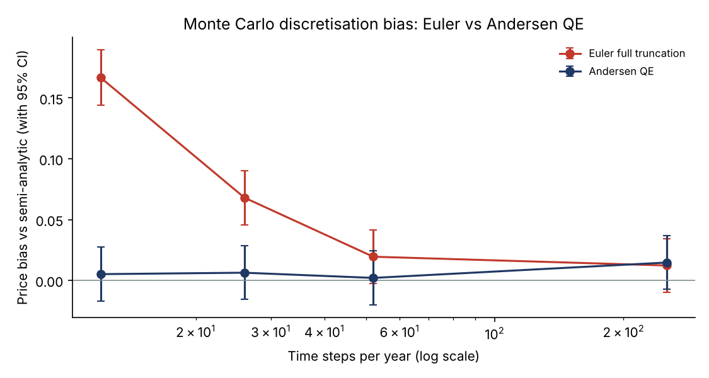
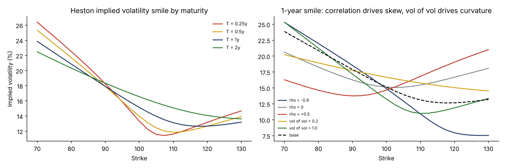
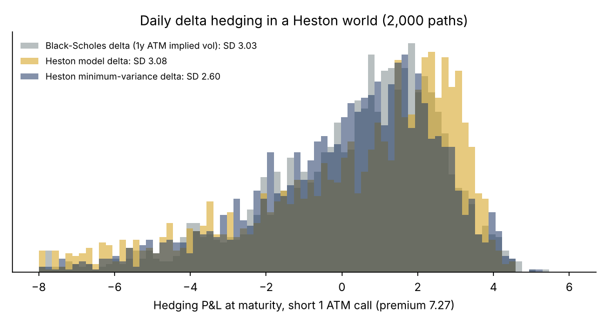

# Derivatives Pricing under the Heston Model: Fourier, COS, Monte Carlo, Calibration and Hedging

A from-scratch Python implementation of the Heston stochastic volatility model, the standard benchmark for equity option smiles, validated against published reference values and an industry numerical library:

1. **Semi-analytic pricing**, with two independent methods: Fourier inversion (Heston's formula, in the "little trap" form) and the COS method (Fang & Oosterlee, 2009).
2. **Greeks**: delta, gamma, rho, and the sensitivity to variance (vega).
3. **Monte Carlo**: the Euler full-truncation and Andersen QE schemes, with antithetic variates and a control variate.
4. **Implied volatility smile**, and how correlation and vol of vol shape it.
5. **Calibration** to a noisy implied-volatility surface.
6. **Model risk on exotics**: barriers, Asians and out-of-the-money puts, Heston vs Black-Scholes.
7. **Delta hedging experiment**: Black-Scholes delta, Heston model delta and minimum-variance delta.

## Validation against published references

| Quantity | This project | Reference |
|---|---|---|
| Call, T = 1, r = 0 (Fang & Oosterlee, 2009) | 5.7851554343 (Fourier), 5.7851554950 (COS, N = 256) | 5.785155450 |
| Call, T = 10, r = 0 (Fang & Oosterlee, 2009) | 22.3189457900 (Fourier) | 22.318945791 |
| Price, r = 2.5% (NAG library) | 7.2743 | 7.2743 |
| Delta | 0.6945 | 0.6945 |
| Gamma | 0.0251 | 0.0251 |
| Rho | 62.1735 | 62.1735 |
| Vega (dC/dv0) | 52.5461 | 52.5461 |

Parameters: S0 = K = 100, kappa = 1.5768, theta = 0.0398, sigma = 0.5751, rho = -0.5711, v0 = 0.0175.

- **Fourier and COS agree to 6e-8** for T = 1 and to 1e-9 for T = 10. Both match the published values to the eighth significant digit; the remaining 1.6e-8 at T = 1 is at the precision of the published figure itself.
- **The COS truncation range uses the fourth cumulant**, as in the original paper. With the second cumulant alone, the range was too narrow for Heston's fat tails and the error plateaued at 4e-5.
- **Black-Scholes checks:** put-call parity holds to 7e-15. A daily-monitored barrier simulated under Black-Scholes matches the closed form with the Broadie-Glasserman-Kou continuity correction (7.181 vs 7.216, 1.1 standard errors).

### A lesson from the validation work

The vectorised delta used for hedging integrates the Fourier integrand up to a finite bound. A first version stopped at 300. In one difficult case (deep in the money, low variance, short maturity), it disagreed with the adaptive reference by 7e-6. A "confirmation" test also stopped at 300 and agreed with the vectorised value, so I first concluded that the reference was wrong.

Inspecting the integral piece by piece showed the opposite: the Heston characteristic function can decay slowly, and the range from 300 to 1,000 still contributes -2.3e-5. Two methods sharing the same wrong assumption had agreed and were both wrong.

The bound is now set adaptively from the decay of the characteristic function for the lowest-variance path. Across the tested cases, the error is now at most 2e-9.

## Monte Carlo



| Time steps per year | Euler full truncation: bias | Andersen QE: bias |
|---|---|---|
| 12 | +0.167 (14.4 standard errors) | +0.005 (0.5 SE) |
| 26 | +0.068 (6.0 SE) | +0.006 (0.6 SE) |
| 52 | +0.019 (1.7 SE) | +0.002 (0.2 SE) |
| 252 | +0.012 (1.1 SE) | +0.015 (1.3 SE) |

Each estimate uses 200,000 paths.

- **The QE scheme has no detectable bias even with monthly steps.** Euler overprices by 14 standard errors at the same step, which is why QE is the industry standard for Heston.
- **Variance reduction.** Antithetic variates cut the variance by a factor of 1.5. Adding the control variate (the discounted terminal price, whose expectation is known exactly) brings the factor to 2.5.

## The volatility smile



- **Correlation drives the skew.** Negative correlation between spot and variance (rho = -0.57) makes low strikes expensive. With rho = 0 the smile becomes symmetric, and positive correlation inverts the skew.
- **Vol of vol drives the curvature.**
- **The smile flattens with maturity**, as mean reversion pulls variance back towards theta.

## Calibration

The calibration targets a surface of 45 options (5 maturities x 9 strikes) generated from known parameters, with 0.2 vol points of quote noise added, and fits all five parameters by vega-weighted least squares on COS prices:

| Start | kappa | theta | sigma | rho | v0 | RMSE (vol points) |
|---|---|---|---|---|---|---|
| Start 1 | 1.438 | 0.0409 | 0.564 | -0.560 | 0.0180 | 0.185 |
| Start 2 | 1.377 | 0.0415 | 0.560 | -0.561 | 0.0181 | 0.184 |
| Start 3 | 1.924 | 0.0382 | 0.628 | -0.563 | 0.0172 | 0.219 (local minimum) |
| **True** | **1.577** | **0.0398** | **0.575** | **-0.571** | **0.0175** | |

- **The well-identified parameters are recovered.** The best fits find rho, v0 and theta close to their true values, and the fit error equals the noise level (0.18-0.19 vol points against 0.2).
- **Kappa is weakly identified.** It trades off against sigma, and one start ends in a local minimum. In practice, calibrations use several starts and often fix or regularise kappa.

## Model risk on exotics

| Product | Heston | Black-Scholes (same 1y ATM vol, 15.1%) | Difference |
|---|---|---|---|
| European call, K = 100 | 7.272 | 7.281 | -0.1% |
| Down-and-out call, K = 100, B = 80 | 7.123 | 7.276 | -2.1% |
| Down-and-in call, K = 100, B = 80 | 0.149 | 0.006 | **x 27** |
| Asian call (daily arithmetic average) | 3.893 | 4.095 | -4.9% |
| Out-of-the-money put, K = 80 | 1.052 | 0.280 | **x 3.8** |

The two models agree on the at-the-money call **by construction** (the same implied volatility). Everywhere else, they disagree. Under Heston, a fall towards the barrier comes with rising volatility (negative correlation), so a down-and-in call is worth 27 times more. A desk pricing barriers with a flat volatility would badly misprice them; this is why exotics desks use stochastic or local volatility models.

## Delta hedging in a Heston world

The world is simulated with Heston (2,000 paths, QE). A trader sells a 1-year at-the-money call at its Heston price (7.27) and rebalances the delta hedge daily.

| Hedge | SD of hedging P&L | As % of premium | Variance vs Black-Scholes hedge (95% CI) |
|---|---|---|---|
| Black-Scholes delta (1y ATM implied vol) | 3.03 | 41.6% | 1.00 |
| Heston model delta | 3.08 | 42.4% | 1.04 (0.92 - 1.17) |
| **Heston minimum-variance delta** | **2.60** | **35.8%** | **0.74 (0.67 - 0.82)** |

The confidence intervals come from a paired bootstrap: all hedges run on the same paths, which are resampled together.



- **The Heston "model delta" is no better than Black-Scholes.** The difference is not statistically significant (the interval contains 1). The model delta holds variance fixed when the spot moves, but with rho = -0.57, variance rises when the spot falls.
- **The minimum-variance delta corrects for this:** Delta_MV = Delta + (rho sigma / S) dC/dv. It cuts the hedging variance by 26%, a significant gain (interval 0.67 - 0.82).
- **Even the best delta leaves 36% of the premium unhedged.** That is volatility risk, which the underlying alone cannot hedge. Hedging it needs a second option (vega hedging).

## Method notes

- **Characteristic function:** the "little trap" form (Albrecher et al., 2007) keeps the complex logarithm continuous.
- **Fourier prices:** adaptive quadrature over successive finite pieces, for reliability when the integrand decays slowly.
- **COS:** truncation range c1 +/- L sqrt(c2 + sqrt(c4)) with L = 12. The cumulants come from finite differences of the log characteristic function.
- **Vectorised Greeks:** Gauss-Legendre quadrature, with paths grouped by variance and an adaptive range for each group. The nodes are cached, because computing them is an O(n^3) eigenvalue problem; caching cut the time per hedging step from 10 seconds to 0.2.
- **QE scheme:** Andersen (2008) with psi_c = 1.5 and gamma1 = gamma2 = 1/2.

## Repository structure

```
├── run_study.py        # validation, Monte Carlo, smile, calibration, exotics (about 30 seconds)
├── run_hedging.py      # delta-hedging experiment (about 2 minutes)
├── src/
│   ├── black_scholes.py   # prices, Greeks, implied vol, barrier formula, BGK correction
│   ├── heston.py          # Fourier and COS pricing, Greeks, minimum-variance delta
│   └── monte_carlo.py     # Euler and QE schemes, variance reduction
└── results/
    ├── figures/
    ├── tables/
    ├── run_log.txt
    └── run_log_hedging.txt
```

## How to run

```bash
pip install -r requirements.txt
python run_study.py
python run_hedging.py
```

## Limitations and next steps

- **Calibration data.** The calibration targets a synthetic surface with known parameters, to test recovery; a live calibration would use market option quotes.
- **Model extensions.** Heston cannot fit short-maturity skews well; jumps (Bates) or rough volatility address this.
- **Hedging.** A next step would add vega hedging with a second option, and transaction costs.

## References

- Heston, S. (1993). A closed-form solution for options with stochastic volatility. *Review of Financial Studies*.
- Albrecher, H., Mayer, P., Schoutens, W. and Tistaert, J. (2007). The little Heston trap. *Wilmott Magazine*.
- Fang, F. and Oosterlee, C. (2009). A novel pricing method for European options based on Fourier-cosine series expansions. *SIAM Journal on Scientific Computing*.
- Andersen, L. (2008). Simple and efficient simulation of the Heston stochastic volatility model. *Journal of Computational Finance*.
- Broadie, M., Glasserman, P. and Kou, S. (1997). A continuity correction for discrete barrier options. *Mathematical Finance*.
- Bakshi, G., Cao, C. and Chen, Z. (1997). Empirical performance of alternative option pricing models. *Journal of Finance*.
- NAG Library, s30nb example results (Heston prices and Greeks).

---

**Author:** Yassine El Bakali, MSc in Actuarial Science (ULB) · yelbakali@yahoo.be
